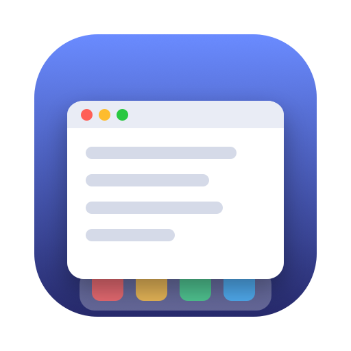

<p align="center">
  
</p>

<h1 align="center">Coward Dock</h1>

<p align="center">
  The macOS Dock stays visible, and hides only while a window gets in its way.<br>
  A tiny menu bar app. No permissions, no Dock restarts, no settings to fiddle with.
</p>

<p align="center">
  <a href="https://github.com/haonlabs/coward-dock/releases/latest"><b>Download the latest release</b></a>
</p>

---

## Why

macOS gives you two choices for the Dock: **always visible**, which takes screen space away from every
window, or **auto-hide**, which hides it even when your desktop is empty. Coward Dock adds the missing
mode in between:

| Situation | Dock |
|---|---|
| No windows, or only windows that stay clear of the Dock | **Visible** |
| A window overlaps or touches the Dock (maximized, tiled, dragged over it) | **Auto-hidden** |
| You close, minimize or hide (⌘H) that window | **Visible again** |
| You switch to a desktop (Space) where nothing overlaps | **Visible** |

A maximized or tiled window hides the Dock and then grows to the bottom of the screen, so you get the
full height while you work and the Dock back as soon as you're done.

## Features

- Lives in the menu bar; the icon shows whether the Dock is currently hidden.
- **Enabled** toggle (⌘E) to pause it any time.
- **Launch at Login**, using the native macOS login item API.
- Works per desktop (Space), with the Dock on the bottom, left or right.
- Quitting or pausing always brings the Dock back.
- Universal binary (Apple Silicon and Intel), macOS 14 Sonoma or later.

## Install

1. Download `CowardDock-<version>.dmg` from [Releases](https://github.com/haonlabs/coward-dock/releases/latest).
2. Open it and drag **Coward Dock** into **Applications**.
3. Launch it from Applications. The icon appears in the menu bar.

### "Coward Dock can't be opened" / "Apple could not verify…"

Release builds aren't notarized by Apple yet, so Gatekeeper blocks the first launch. Allow it once, either:

- Open **System Settings → Privacy & Security**, scroll down, and click **Open Anyway** next to Coward Dock, or
- run this in Terminal:

  ```sh
  xattr -dr com.apple.quarantine "/Applications/Coward Dock.app"
  ```

Prefer not to trust a binary? [Build it yourself](#build-from-source). It takes about a minute.

## Usage

Click the menu bar icon:

| Item | What it does |
|---|---|
| *Status line* | `Dock visible`, `Dock hidden: a window overlaps it`, or `Paused` |
| **Enabled** ⌘E | Turn the behavior on or off. Turning it off shows the Dock. |
| **Launch at Login** | Start Coward Dock when you log in. It also appears in System Settings → General → Login Items. |
| **About Coward Dock** | Version info |
| **Quit Coward Dock** ⌘Q | Quit and restore the Dock |

## How it works

Twice a second, Coward Dock:

1. Measures the area the Dock reserves on screen (from `NSScreen.visibleFrame`, while the Dock is visible).
2. Lists the normal app windows on the current desktop (`CGWindowListCopyWindowInfo`). Reading window
   positions doesn't need Screen Recording permission.
3. If any window overlaps or touches that area, it turns on Dock auto-hide; otherwise it turns it off.

Auto-hide is toggled with `CoreDockSetAutoHideEnabled`, the private function the Dock itself uses. That's
why no Automation or Accessibility permission is needed and the Dock never restarts. A future macOS
release could change or remove it. If that happens, the fallback is
`tell application "System Events" to set autohide of dock preferences to …`, which needs the Automation permission.

The source is three small files:

```
Sources/main.swift          menu bar UI, Enabled / Launch at Login, lifecycle
Sources/DockWatcher.swift   Dock measurement, window scan, overlap rule
Tests/main.swift            self-check for the overlap rule
scripts/make-icon.swift     draws the app icon
build.sh                    builds the .app and .dmg
```

## Build from source

Requirements: macOS 14+ and the Xcode Command Line Tools (`xcode-select --install`). Full Xcode isn't needed.

```sh
git clone https://github.com/haonlabs/coward-dock.git
cd coward-dock
./build.sh
```

This runs the self-check, compiles a universal binary, draws the icon, signs the app ad hoc, and creates:

- `build/Coward Dock.app`
- `build/CowardDock-<version>.dmg`

The version comes from `CFBundleShortVersionString` in `Info.plist`.

### Signed and notarized builds

With an Apple Developer account, set these and the build is signed with your Developer ID and the DMG is
notarized and stapled, so users get no Gatekeeper warning:

```sh
xcrun notarytool store-credentials coward-dock   # once
SIGN_ID="Developer ID Application: Your Name (TEAMID)" NOTARY_PROFILE=coward-dock ./build.sh
```

## Troubleshooting

**The Dock stays hidden after Coward Dock crashed or was force-killed.** Run:

```sh
defaults write com.apple.dock autohide -bool false && killall Dock
```

**The Dock hides although no window seems to touch it.** Coward Dock watches the whole screen edge strip
the Dock reserves, not just the Dock bar, so a window in a bottom corner counts too. Also check for
off-screen or tiny windows that some apps keep open.

**Launch at Login doesn't stick.** Make sure the app runs from `/Applications`, and allow it under
System Settings → General → Login Items.

## Known limitations

- Polls every 0.5 s instead of reacting to window events. CPU use is negligible, but hiding can lag by up to half a second.
- Not tested with multiple displays or Stage Manager yet. Reports are welcome.
- Fullscreen apps already hide the Dock themselves; Coward Dock doesn't change that.

## Contributing

Issues and pull requests are welcome. Please keep it small: Coward Dock aims to stay a few hundred lines
with no dependencies. Run `./build.sh` before opening a PR; it fails if the overlap self-check fails.
When you change the overlap rule, add a case to `Tests/main.swift`.

## License

[MIT](LICENSE)
